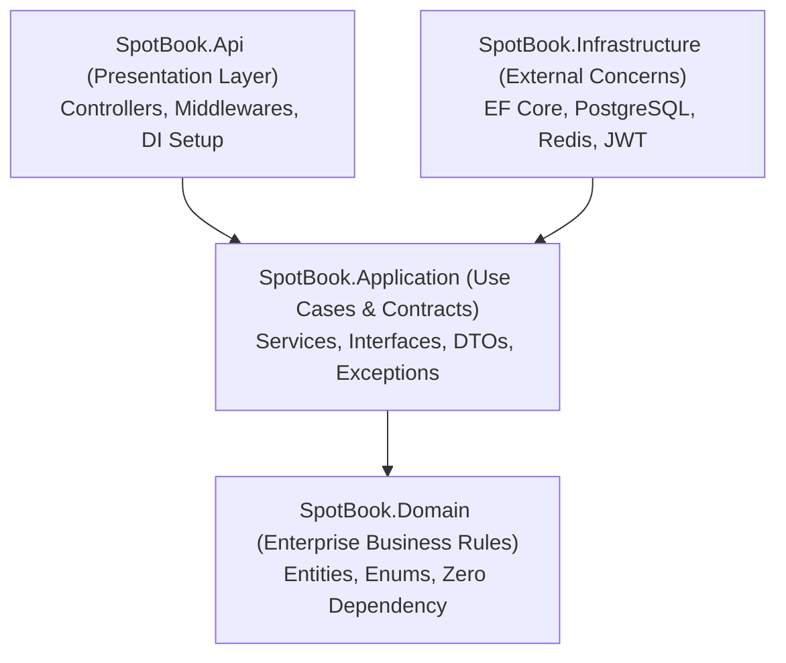
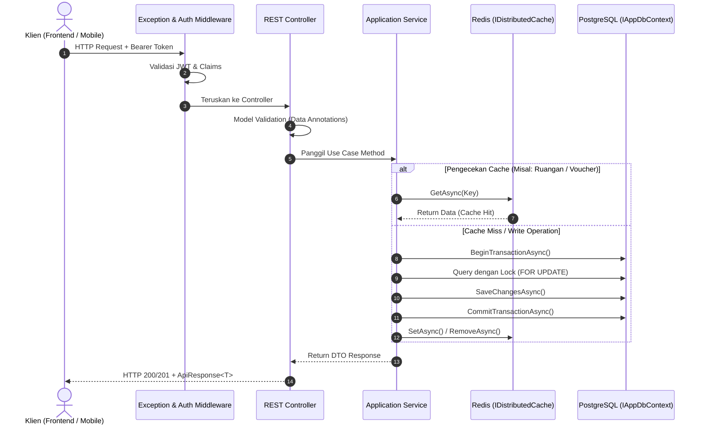

# Arsitektur Sistem: SpotBook

Dokumen ini menguraikan arsitektur sistem, pembagian lapisan kode (*Separation of Concerns*), serta pola desain yang diimplementasikan pada backend **SpotBook**.

---

## 1. Pola Arsitektur: Clean Architecture (Onion / Hexagonal)

SpotBook mengadopsi pola **Clean Architecture** dengan prinsip ketergantungan mengarah ke dalam (*Inversion of Control*). Lapisan inti tidak memiliki dependensi terhadap framework web atau teknologi database spesifik.



### Rincian Tanggung Jawab Proyek

| Proyek | Tanggung Jawab | Komponen Utama |
| :--- | :--- | :--- |
| **`SpotBook.Domain`** | Inti bisnis tanpa dependensi pihak ketiga. | Entitas (`User`, `Space`, `Booking`, `PaymentTransaction`, `Voucher`, `ReportJob`) & Enum (`BookingStatus`, `PaymentStatus`, dll.). |
| **`SpotBook.Application`** | Logika bisnis aplikasi, abstraksi antarmuka, DTOs, dan penanganan validasi. | `BookingService`, `PaymentService`, `SpaceService`, `VoucherService`, `AuthService`, interface `IAppDbContext`, `ApiResponse<T>`. |
| **`SpotBook.Infrastructure`** | Implementasi detail eksternal (Database, Cache, Security). | `AppDbContext`, EF Configurations, `CacheService` (Redis), `JwtService`, Database Migrations. |
| **`SpotBook.Api`** | Titik masuk aplikasi (HTTP Host). Mengelola autentikasi JWT, middleware, routing, dan Swagger/Scalar UI. | `Program.cs`, `BaseApiController`, `Controllers/`, `GlobalExceptionHandlerMiddleware`. |

---

## 2. Alur Eksekusi Data (Request Lifecycle)



---

## 3. Pola Desain Kunci (Key Design Patterns)

### A. Pessimistic Row-Level Locking (Pencegahan Double Booking)
Untuk menjamin integritas reservasi pada sistem dengan konkurensi tinggi, sistem menggunakan penguncian baris eksplisit:
- Kueri `SELECT ... FOR UPDATE` pada tabel `Spaces` mengunci baris ruangan tertentu selama durasi transaksi DB.
- Request lain yang mencoba memesan ruangan yang sama akan diantrekan secara atomik oleh engine database PostgreSQL.
- Detail pertimbangan arsitektur tercatat pada `documents/adr/ADR-002-postgresql-pessimistic-locking-for-double-booking.md`.

### B. Cache-Aside Pattern (Redis)
- **Read Path**: Aplikasi memeriksa memori Redis terlebih dahulu (`spaces:active`, `spaces:{id}`, `voucher:{code}`). Jika data ditemukan (*cache hit*), data langsung dikembalikan dalam tempo $< 1\text{ ms}$. Jika data tidak ada (*cache miss*), data diambil dari PostgreSQL dan disimpan ke Redis dengan TTL 15–30 menit.
- **Write Path**: Setiap mutasi (create/update/delete ruangan atau penggunaan voucher) secara otomatis memicu pembersihan (*cache eviction*) melalui `_cacheService.RemoveAsync()`.

### C. Standardized API Response & Centralized Exception Handling
Seluruh endpoint menghasilkan struktur data seragam melalui pembungkus `ApiResponse<T>`:
```json
{
  "success": true,
  "message": "Operasi berhasil.",
  "data": { ... },
  "errors": null
}
```
Setiap kesalahan bisnis yang dilempar dari Application layer (`BadRequestException`, `NotFoundException`, `UnauthorizedAccessException`) ditangkap oleh `GlobalExceptionHandlerMiddleware` dan dipetakan ke kode status HTTP yang tepat:
- `BadRequestException` $\rightarrow$ **HTTP 400 Bad Request**
- `UnauthorizedAccessException` $\rightarrow$ **HTTP 401 Unauthorized**
- `NotFoundException` $\rightarrow$ **HTTP 404 Not Found**
- Unhandled Crash $\rightarrow$ **HTTP 500 Internal Server Error**

---

## 4. Keamanan & Autentikasi

1. **Password Hashing**: Menggunakan algoritma **BCrypt** (`BCrypt.Net-Next`) dengan salt acak yang aman dari serangan *rainbow table*.
2. **Access Token (JWT)**: Ditandatangani menggunakan algoritma simetris **HMAC-SHA256** dengan masa aktif terbatas (default: 60 menit). Memuat klaim identitas: `sub`, `nameid`, `email`, `name`, `role`, dan `jti`.
3. **Refresh Token Rotation**: Dihasilkan menggunakan generator angka acak kriptografi (`RandomNumberGenerator`, 64 bytes base64) dengan masa kedaluwarsa 7 hari untuk memperpanjang sesi tanpa meminta kredensial ulang pengguna.
4. **Webhook Security**: Webhook dari Midtrans divalidasi menggunakan verifikasi hash SHA-512 dua arah (`order_id + status_code + gross_amount + server_key`).
