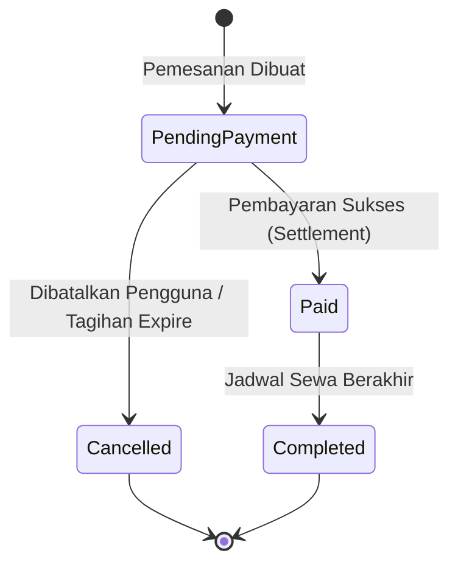

# Domain Context & Ubiquitous Language: SpotBook

Dokumen ini mendefinisikan bahasa standar (*Ubiquitous Language*) dan aturan invarian bisnis domain dalam sistem reservasi ruang **SpotBook**. Seluruh pengembang dan agen diwajibkan menggunakan istilah resmi di bawah ini tanpa mencampuradukkan makna teknis.

---

## 1. Kamus Domain (Glossary)

### A. Core Reservation Concepts
* **Space (Ruangan)**: Aset fisik yang dapat disewa oleh pengguna untuk durasi tertentu (contoh: *Meeting Room*, *Co-working Desk*, *Event Hall*). Ruangan memiliki kapasitas maksimum (`Capacity`), tarif sewa per jam (`PricePerHour`), serta status ketersediaan operasional (`IsActive`).
* **Booking (Pemesanan / Reservasi)**: Perjanjian sewa mengikat antara Pengguna dan Ruangan untuk rentang waktu spesifik (`StartTime` hingga `EndTime`). Pemesanan memiliki siklus hidup status tertentu.
* **BookingCode (Kode Pemesanan)**: Pengenal unik publik untuk reservasi dengan format standar `SB-yyyyMMdd-XXXX` (contoh: `SB-20261029-920B`). Digunakan sebagai `OrderId` saat berkomunikasi dengan payment gateway.
* **DurationInHours (Durasi Sewa)**: Selisih waktu antara `EndTime` dan `StartTime` dalam satuan jam desimal.
* **BasePrice (Harga Dasar)**: Biaya murni pemesanan sebelum potongan voucher, dihitung dari:
  $$\text{BasePrice} = \text{DurationInHours} \times \text{PricePerHour}$$
* **TotalAmount (Total Pembayaran)**: Jumlah nominal rupiah bersih yang wajib dibayar oleh pengguna setelah potongan diskon.

### B. Promo & Incentive Concepts
* **Voucher (Kupon Diskon)**: Instrumen promosi dengan kode alfanumerik unik (`Code`) yang memberikan potongan harga pada saat pemesanan ruangan.
* **DiscountType (Tipe Diskon)**:
  - `Percentage`: Diskon berbasis persentase terhadap `BasePrice`. Dapat dibatasi oleh batas atas nominal (`MaxDiscountAmount`).
  - `FixedAmount`: Diskon bernilai nominal tetap (contoh: potongan Rp 50.000).
* **Quota (Kuota Voucher)**: Jumlah maksimum kali voucher boleh digunakan di seluruh sistem.
* **UsedCount (Hitungan Terpakai)**: Akumulasi pemakaian voucher yang telah berhasil diikat ke dalam pemesanan aktif.
* **MinOrderAmount (Minimal Nilai Transaksi)**: Syarat nilai `BasePrice` minimum agar voucher sah untuk diaplikasikan.
* **Validity Period (Masa Berlaku)**: Rentang waktu absolut (`ValidFrom` s.d. `ValidUntil`) di mana voucher diakui berlaku.

### C. Financial & Gateway Concepts
* **PaymentTransaction (Transaksi Pembayaran)**: Entitas finansial yang merekam tagihan pembayaran pemesanan ke payment gateway (Midtrans).
* **PaymentGatewayRef (Referensi Gateway)**: Token identifikasi yang diterbitkan oleh Midtrans (Snap Token).
* **PaymentUrl (URL Pembayaran)**: Tautan pengalihan antarmuka Midtrans Snap tempat pelanggan memilih kanal pembayaran (QRIS, VA, Kartu Kredit).
* **GrossAmount (Nominal Bruto Gateway)**: Jumlah uang yang ditagihkan melalui payment gateway.
* **SignatureKey (Kunci Tanda Tangan Webhook)**: Hash keamanan SHA-512 yang diterbitkan Midtrans untuk memvalidasi keaslian notifikasi status pembayaran.

### D. Identity & Roles
* **User (Pengguna)**: Akun pengguna sistem yang terdaftar dengan kredensial email unik dan kata sandi ter-hash (BCrypt).
* **Customer**: Peran pengguna standar yang memiliki hak untuk mencari ruangan, memesan, menerapkan voucher, dan membayar.
* **Admin**: Peran manajemen yang memiliki otoritas membuat, memperbarui, dan menonaktifkan Ruangan dan Voucher.

---

## 2. Status Domain & Mesin Status (State Machine)

### A. BookingStatus

1. **`PendingPayment`**: Pemesanan telah mengunci slot jadwal ruangan dan menunggu pelunasan tagihan.
2. **`Paid`**: Pembayaran terverifikasi lunas. Slot jadwal sah menjadi hak penyewa.
3. **`Cancelled`**: Pemesanan dibatalkan sebelum terbayar. Slot jadwal dilepaskan kembali, dan kuota voucher dikembalikan.
4. **`Completed`**: Waktu reservasi telah usai.

### B. PaymentStatus
1. **`Unpaid`**: Tagihan telah dibuat tetapi belum dibayar.
2. **`Settled`**: Dana berhasil diterima dan diselesaikan oleh gateway.
3. **`Expired`**: Waktu bayar (Snap session) telah habis tanpa ada penyelesaian pembayaran.

---

## 3. Aturan Invarian Bisnis (Business Invariants)

1. **Invarian Jadwal (No Overlap)**:
   Tidak boleh ada dua pemesanan berstatus non-`Cancelled` pada `SpaceId` yang sama yang memiliki waktu saling bertubrukan:
   $$\neg (\text{Start}_A < \text{End}_B \land \text{End}_A > \text{Start}_B)$$
2. **Invarian Durasi Minimum**:
   Durasi pemesanan minimal adalah 1.0 jam ($(\text{EndTime} - \text{StartTime}) \ge 1\text{ jam}$).
3. **Invarian Waktu Masa Depan**:
   `StartTime` pemesanan baru harus selalu berada di masa depan terhadap waktu UTC server saat reservasi diajukan.
4. **Invarian Kuota Voucher**:
   Nilai `UsedCount` tidak boleh melebihi `Quota`. Pemakaian voucher wajib serialized.
5. **Invarian Batas Minimal Pembayaran Gateway**:
   Total pembayaran (`TotalAmount`) setelah diskon voucher tidak boleh $\le 0$. Nilai minimum dipatok pada **Rp 1** agar kompatibel dengan sistem perbankan/gateway Midtrans Snap.
6. **Invarian Imutabilitas Pembatalan**:
   Pemesanan yang telah berstatus `Cancelled` **tidak dapat dihidupkan kembali** menjadi `Paid` oleh webhook pembayaran yang terlambat datang.
