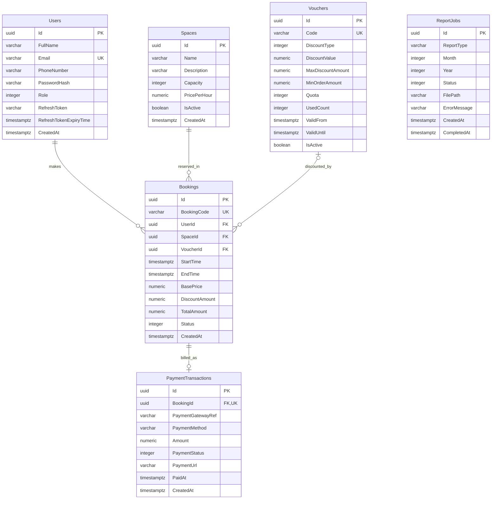

# Desain Basis Data: SpotBook

Dokumen ini mendokumentasikan skema relasional, spesifikasi tabel, indeks, serta relasi entitas pada database **PostgreSQL 16** untuk sistem **SpotBook**.

---

## 1. Diagram Relasi Entitas (ERD)

---

## 2. Rincian Kamus Data (Data Dictionary)

### A. Tabel `Users`
Menyimpan akun pengguna dan kredensial autentikasi.

| Kolom | Tipe Data | Nullable | Keterangan & Batasan |
| :--- | :--- | :---: | :--- |
| `Id` | `uuid` | No | Primary Key (`Guid.NewGuid()`) |
| `FullName` | `varchar(100)` | No | Nama lengkap pengguna |
| `Email` | `varchar(150)` | No | Email akun, **Unique Index** |
| `PhoneNumber` | `varchar(20)` | Yes | Nomor telepon seluler |
| `PasswordHash` | `text` | No | Kata sandi terenkripsi (BCrypt) |
| `Role` | `integer` | No | `1`: Customer, `2`: Admin |
| `RefreshToken` | `varchar(255)` | Yes | Token rotasi sesi |
| `RefreshTokenExpiryTime` | `timestamptz` | Yes | Masa berlaku refresh token |
| `CreatedAt` | `timestamptz` | No | Waktu pembuatan akun (UTC) |

### B. Tabel `Spaces`
Menyimpan data fisik ruangan yang dapat disewa.

| Kolom | Tipe Data | Nullable | Keterangan & Batasan |
| :--- | :--- | :---: | :--- |
| `Id` | `uuid` | No | Primary Key |
| `Name` | `varchar(100)` | No | Nama ruangan / spot |
| `Description` | `varchar(500)` | Yes | Deskripsi fasilitas |
| `Capacity` | `integer` | No | Daya tampung maksimal orang |
| `PricePerHour` | `numeric(18,2)` | No | Tarif sewa per jam (IDR) |
| `IsActive` | `boolean` | No | Status operasional ruangan (default: `true`) |
| `CreatedAt` | `timestamptz` | No | Waktu penambahan ruangan (UTC) |

### C. Tabel `Vouchers`
Menyimpan kupon promosi dan kontrol kuota.

| Kolom | Tipe Data | Nullable | Keterangan & Batasan |
| :--- | :--- | :---: | :--- |
| `Id` | `uuid` | No | Primary Key |
| `Code` | `varchar(50)` | No | Kode kupon unik (uppercase), **Unique Index** |
| `DiscountType` | `integer` | No | `1`: Percentage, `2`: FixedAmount |
| `DiscountValue` | `numeric(18,2)` | No | Nilai diskon (% atau nominal IDR) |
| `MaxDiscountAmount` | `numeric(18,2)` | Yes | Plafon diskon maksimal jika persentase |
| `MinOrderAmount` | `numeric(18,2)` | No | Minimal nilai transaksi untuk klaim |
| `Quota` | `integer` | No | Batas kuota total pemakaian |
| `UsedCount` | `integer` | No | Akumulasi pemakaian aktif (default: `0`) |
| `ValidFrom` | `timestamptz` | No | Waktu awal voucher berlaku |
| `ValidUntil` | `timestamptz` | No | Waktu akhir voucher berlaku |
| `IsActive` | `boolean` | No | Saklar aktifasi voucher |

### D. Tabel `Bookings`
Menyimpan riwayat dan data reservasi ruangan.

| Kolom | Tipe Data | Nullable | Keterangan & Batasan |
| :--- | :--- | :---: | :--- |
| `Id` | `uuid` | No | Primary Key |
| `BookingCode` | `varchar(30)` | No | Kode reservasi publik (`SB-yyyyMMdd-XXXX`), **Unique Index** |
| `UserId` | `uuid` | No | FK ke `Users(Id)` (`ON DELETE RESTRICT`) |
| `SpaceId` | `uuid` | No | FK ke `Spaces(Id)` (`ON DELETE RESTRICT`) |
| `VoucherId` | `uuid` | Yes | FK ke `Vouchers(Id)` (`ON DELETE SET NULL`) |
| `StartTime` | `timestamptz` | No | Waktu mulai sewa (UTC) |
| `EndTime` | `timestamptz` | No | Waktu selesai sewa (UTC) |
| `BasePrice` | `numeric(18,2)` | No | Harga dasar kotor sebelum diskon |
| `DiscountAmount` | `numeric(18,2)` | No | Total potongan diskon voucher |
| `TotalAmount` | `numeric(18,2)` | No | Total nominal yang wajib dibayar (min: Rp 1) |
| `Status` | `integer` | No | `1`: PendingPayment, `2`: Paid, `3`: Cancelled, `4`: Completed |
| `CreatedAt` | `timestamptz` | No | Waktu pembuatan reservasi (UTC) |

### E. Tabel `PaymentTransactions`
Menyimpan rekaman integrasi tagihan Midtrans.

| Kolom | Tipe Data | Nullable | Keterangan & Batasan |
| :--- | :--- | :---: | :--- |
| `Id` | `uuid` | No | Primary Key |
| `BookingId` | `uuid` | No | FK ke `Bookings(Id)`, **Unique Key** (`ON DELETE CASCADE`) |
| `PaymentGatewayRef`| `varchar(100)` | Yes | Midtrans Snap Token |
| `PaymentMethod` | `varchar(50)` | Yes | Metode pembayaran yang dipilih pelanggan |
| `Amount` | `numeric(18,2)` | No | Nilai tagihan transaksi |
| `PaymentStatus` | `integer` | No | `1`: Unpaid, `2`: Settled, `3`: Expired |
| `PaymentUrl` | `varchar(500)` | Yes | URL pengalihan Midtrans Snap |
| `PaidAt` | `timestamptz` | Yes | Waktu pelunasan dari webhook Midtrans (UTC) |
| `CreatedAt` | `timestamptz` | No | Waktu pembuatan invoice (UTC) |

### F. Tabel `ReportJobs`
Menyimpan status antrean pekerjaan ekspor laporan asinkron.

| Kolom | Tipe Data | Nullable | Keterangan & Batasan |
| :--- | :--- | :---: | :--- |
| `Id` | `uuid` | No | Primary Key |
| `ReportType` | `varchar(100)` | No | Tipe laporan (misal: "MonthlySalesReport") |
| `Month` | `integer` | No | Bulan laporan (1–12) |
| `Year` | `integer` | No | Tahun laporan |
| `Status` | `integer` | No | `1`: Pending, `2`: Processing, `3`: Completed, `4`: Failed |
| `FilePath` | `varchar(500)` | Yes | Lokasi penyimpanan fisik file laporan |
| `ErrorMessage` | `varchar(1000)`| Yes | Pesan kesalahan jika job gagal |
| `CreatedAt` | `timestamptz` | No | Waktu job didaftarkan |
| `CompletedAt` | `timestamptz` | Yes | Waktu job selesai |

---

## 3. Strategi Pengindeksan (Indexing Strategy)

1. **`Users_Email_Idx`**: B-Tree Unique Index pada `Users("Email")` untuk pencarian login cepat $O(\log n)$ dan jaminan email tunggal.
2. **`Vouchers_Code_Idx`**: B-Tree Unique Index pada `Vouchers("Code")` untuk klaim voucher instan.
3. **`Bookings_Code_Idx`**: B-Tree Unique Index pada `Bookings("BookingCode")` untuk lookup webhook Midtrans.
4. **`Bookings_Overlap_Idx`**: Composite Index pada `Bookings("SpaceId", "StartTime", "EndTime")` untuk mempercepat query pengecekan bentrok jadwal.
